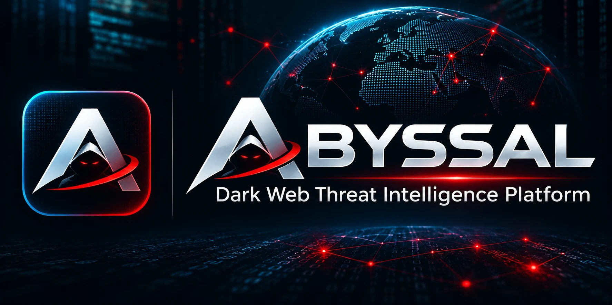
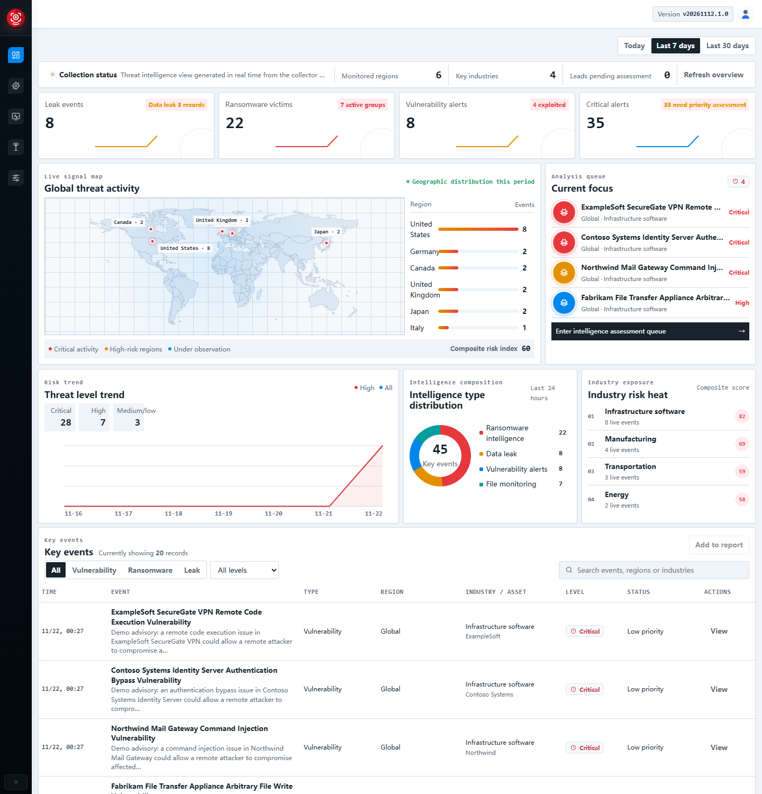
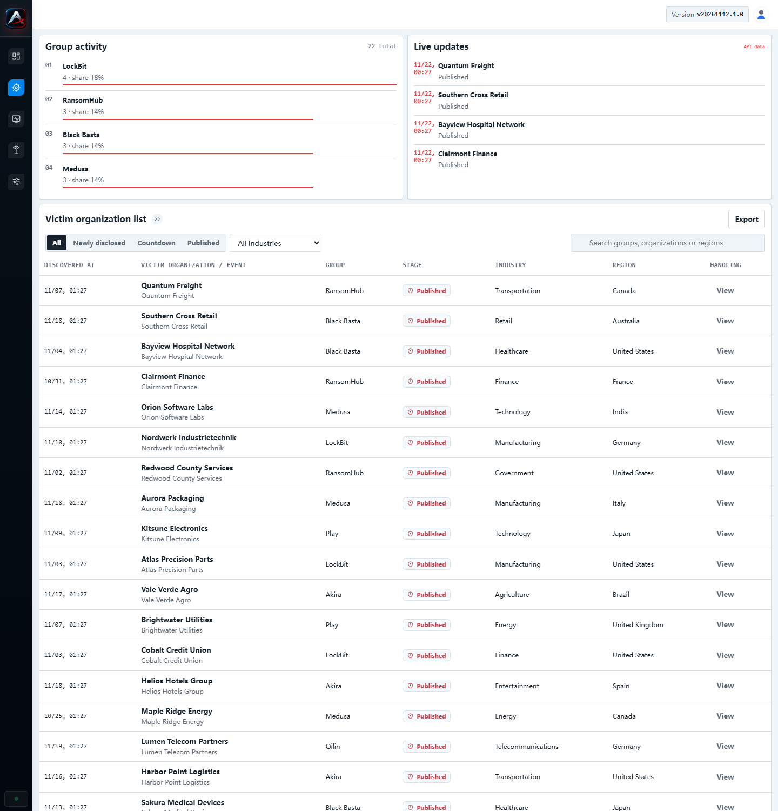
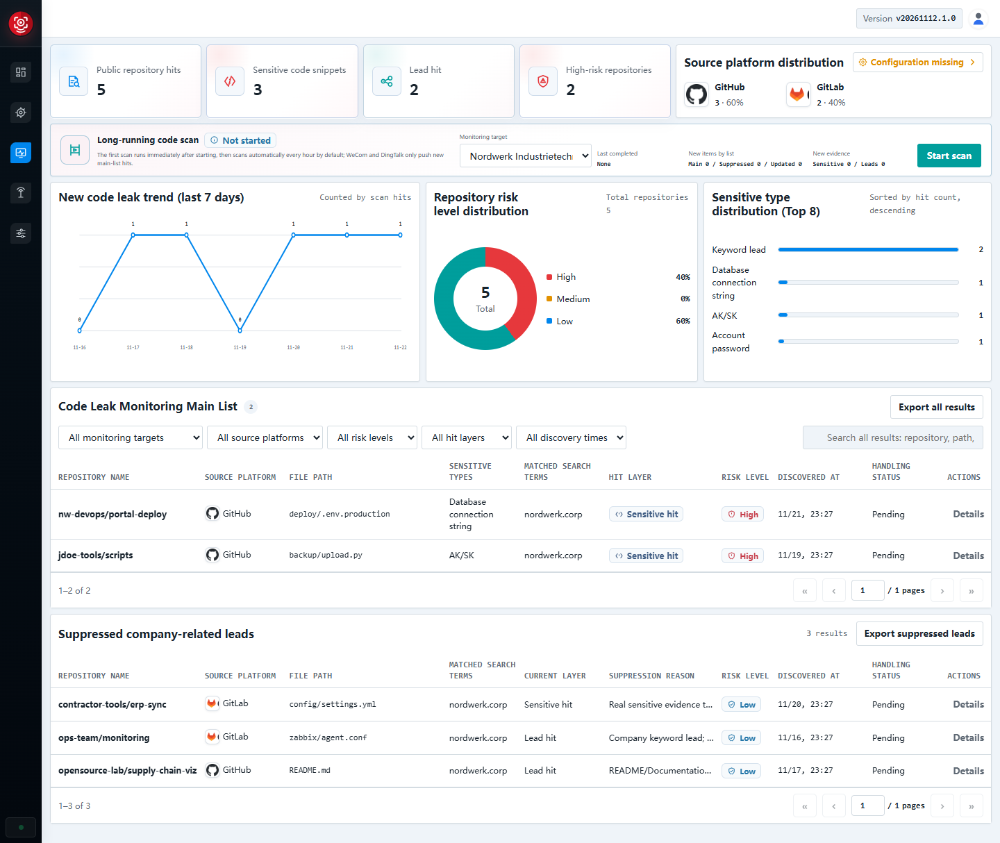
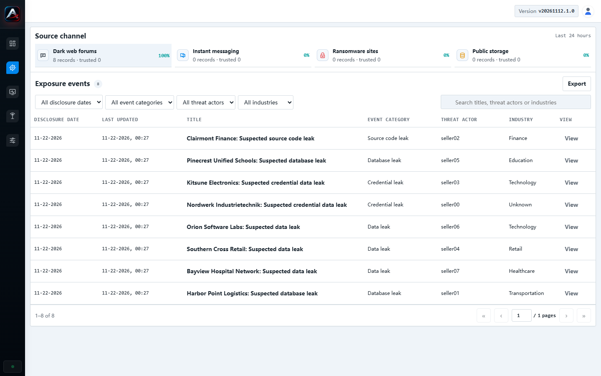
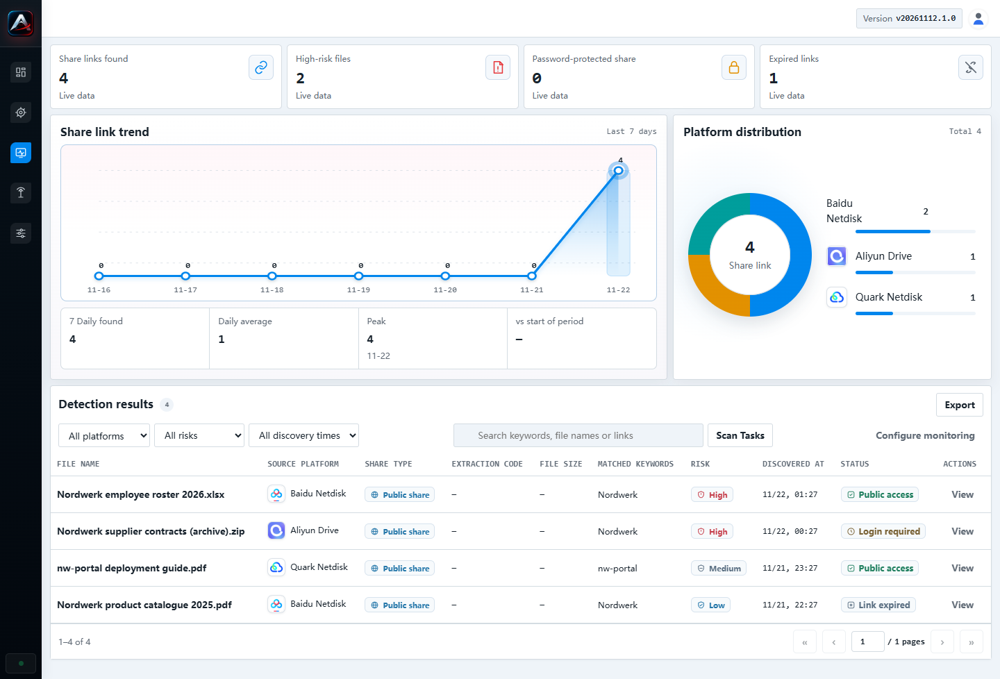
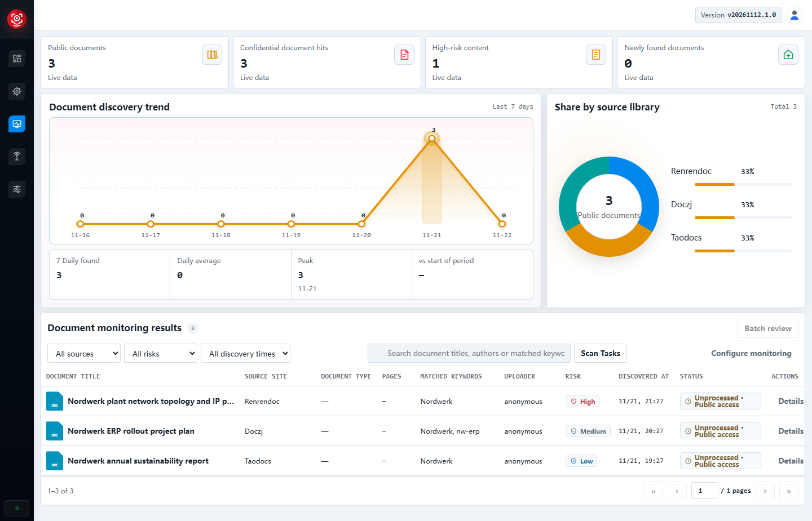
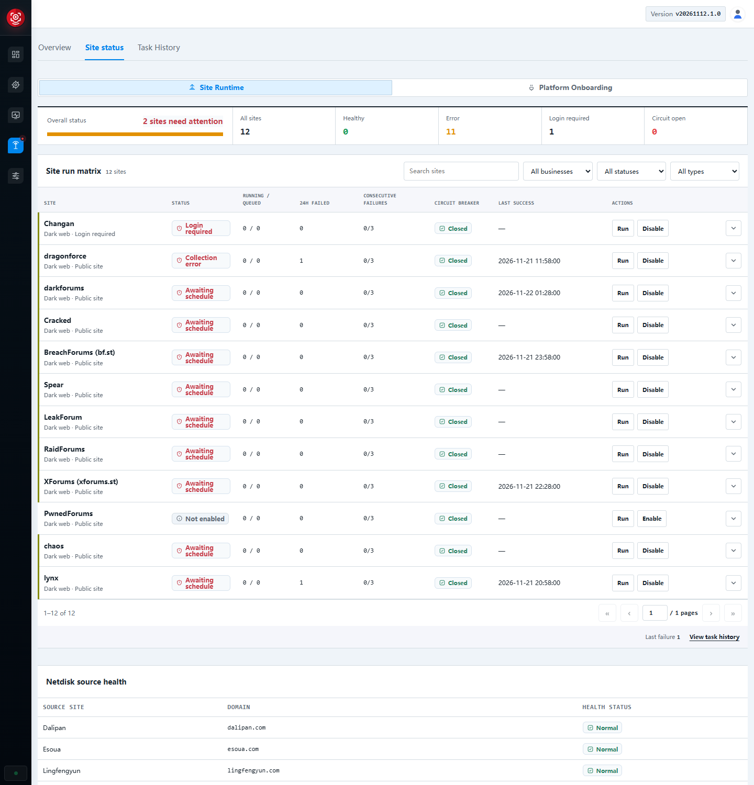
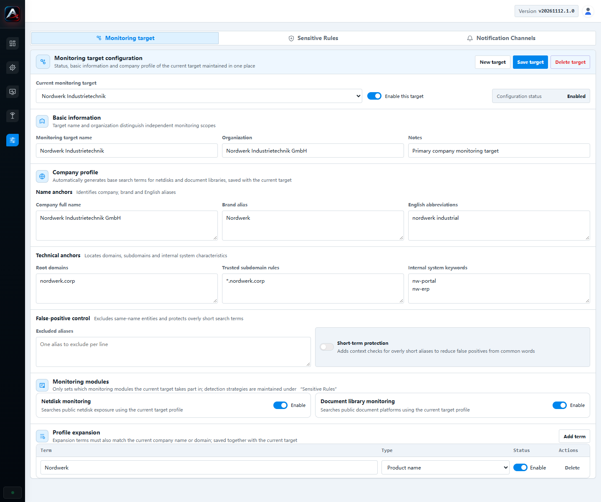

<p align="center"></p>

# Abyssal

[](https://github.com/mithunnavigator/Abyssal/releases/latest) [](LICENSE)

Abyssal centrally monitors leads related to the dark web, ransomware, and code and file exposure, and supports intelligence search, evidence verification and enterprise risk notification.

[Download the latest release](https://github.com/mithunnavigator/Abyssal/releases/latest) · [Installation and operations](docs/USAGE.md) · [Report an issue](https://github.com/mithunnavigator/Abyssal/issues)

## ⬇️ Download

| Release | Platform | Download | Size |
| --- | --- | --- | --- |
| [v20261112.1.0](https://github.com/mithunnavigator/Abyssal/releases/tag/v20261112.1.0) (latest) | Windows x64 | [Abyssal-v20261112.1.0-windows.zip](https://github.com/mithunnavigator/Abyssal/releases/download/v20261112.1.0/Abyssal-v20261112.1.0-windows.zip) | 4.7 MB |

SHA-256: `54dd85565cc7aa6eb359c86e2719e2dbeb55d337a4aca0a994bf74efa1ba1814`

Linux / WSL users can clone the repository instead (see [Quick start](#-quick-start)). All versions are listed on the [Releases page](https://github.com/mithunnavigator/Abyssal/releases).

## ✨ Core features

| Feature | What it does |
| --- | --- |
| Dark web and data leak monitoring | Tracks leads from forums and marketplace sites, showing leak type, disclosure time, source and original evidence. |
| Ransomware event tracking | Aggregates ransomware group claims and victim company information, filterable by industry, region and disclosure stage. |
| Code leak monitoring | Searches GitHub, GitLab and Gitee for company-related code, identifies risks such as credentials, keys and internal addresses, and supports continuous scanning and false-positive review. |
| Document library and netdisk monitoring | Discovers public documents and share links by company keyword, showing file lists, access status and hit evidence. |
| Unified search and situation awareness | Searches ransomware, leak and vulnerability intelligence, shows risk trends, geographic distribution and key events, and exports results. |
| Enterprise monitoring and notifications | Configures names, domains, project terms and detection rules per company, and pushes new hits to WeCom and DingTalk. |
| Collection management | Manages sources, login sessions and scheduled tasks, and shows run progress, failure records and Tor bridge status. |
| Deployment and maintenance | One-click Windows startup, online updates and failure rollback; supports Linux / WSL startup, data migration and account permission management. |

GitHub search, ransomware intelligence sync and notification channels require the corresponding authentication. Library and netdisk monitoring cover the onboarded public sources; see the [usage guide](docs/USAGE.md) for configuration details.

## 📸 Interface preview

The following screenshots of the current interface use demo data.

### Threat situation overview



### Ransomware event tracking



### Code leak monitoring



<details>
<summary>Show more: intelligence search, data leaks, netdisks, document libraries, collection management, monitoring configuration</summary>

### Intelligence search


### Data leak monitoring



### Netdisk monitoring



### Document library monitoring



### Collection management



### Enterprise monitoring configuration



</details>

## 🚀 Quick start

### Windows

1. Download [Abyssal-v20261112.1.0-windows.zip](https://github.com/mithunnavigator/Abyssal/releases/download/v20261112.1.0/Abyssal-v20261112.1.0-windows.zip) (or the latest package from [Releases](https://github.com/mithunnavigator/Abyssal/releases/latest)) and extract it.
2. Double-click `darkweb.cmd`, choose a data drive when prompted, and wait for dependencies to install and services to start.
3. Open [http://localhost:5174](http://localhost:5174), log in and configure monitoring targets and sources.

Use `darkweb.cmd` to start it again later; run online updates from the version menu in the top-right corner of the page.

### Linux / WSL

```bash
git clone https://github.com/mithunnavigator/Abyssal.git
cd Abyssal
bash darkweb_collector/scripts/start_all_services_wsl.sh start
```

After startup, visit [http://localhost:5174](http://localhost:5174).

## 📖 More documentation

- [Installation, updates and operations](docs/USAGE.md)
- [Database and mirror migration](darkweb_collector/DATA_MIGRATION.md)
- [Public social platform lead monitoring](darkweb_collector/SOCIAL_MONITORING.md)
- [Handling code monitoring false positives](CODE_MONITORING_FALSE_POSITIVE_PLAYBOOK.md)
- [Changelog](CHANGELOG.md) · [Third-party licenses](THIRD_PARTY_NOTICES.md)

## ⚖️ License

Abyssal is licensed under the [MIT License](LICENSE).

Copyright (c) 2026 Mithun Sanghavi.

Third-party components, such as Microsoft Garnet, remain under their own licenses; see [THIRD_PARTY_NOTICES.md](THIRD_PARTY_NOTICES.md).
